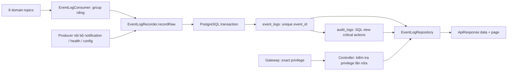

# Event log và audit log — #192

## Luồng ghi event



Consumer đọc `nexus.{user,catalog,commerce,payment,inventory,shipment,rating,auction}.events`
với group `nexus.notification.event-log.v1`, độc lập group tạo notification. Group
mới đọc từ `earliest`; group đã có offset tiếp tục vị trí đã commit.

Listener dùng StringDeserializer riêng để không làm mất field envelope mà phiên bản
Java chưa biết. Recorder kiểm tra các field envelope bắt buộc, lưu nguyên JSON text
vào `raw_envelope`, đồng thời giữ JSONB trong `payload` để tìm kiếm. Cột `payload`
ở DB chứa **cả envelope**; `data.payload` ở API detail là payload nghiệp vụ bên trong.
`data.envelope` chứa đầy đủ envelope; `data.rawEnvelope` là text gốc, giữ cả spacing.
Không ghi nội dung payload vào application log.

Mỗi lần ghi là một transaction. Unique `event_id` + `ON CONFLICT DO NOTHING`
chống race giữa nhiều consumer/retry. Bản ghi đầu tiên thắng, event gửi lại không
sửa payload, actor hoặc receivedAt. SQL view audit đọc chính row đó nên không có
trạng thái log đã commit nhưng audit chưa commit. Nếu producer nội bộ gọi
`EventLogRecorder.record(envelope)` trong transaction hiện tại, row log rollback
cùng transaction đó. Đừng gọi recorder từ một transaction quản lý database khác
rồi coi hai database là atomic.

DB lỗi thì listener throw; error handler retry mỗi giây không giới hạn, không
acknowledge/bỏ record lỗi. Record JSON/envelope hỏng sẽ chặn partition cho tới khi
được xử lý vận hành; không có DLT tự động trong task này. Không bật consumer auto
commit. Không sửa eventId khi retry. Migrations V1–V3 giữ nguyên; V4 tạo unique
index, raw/source columns và audit view. Nếu DB cũ đã có eventId trùng, V4 fail để
người vận hành đối chiếu dữ liệu, không tự xóa lịch sử.

## Audit và metadata

Audit chỉ gồm `UserUpdated`, `UserDeleted`, `UserRoleAssigned`,
`OrderRefundRequested`, `OrderRefundCompleted`, `SystemConfigUpdated`. `action`
là tên event chính xác. `actorId` lấy từ `payload.actorId` (fallback `operatorId`),
không lấy từ người đang xem API. Actor thiếu/sai UUID để null; không làm mất event.
`entityId` luôn là aggregateId gốc. Refund theo aggregate **Order**, không lấy
refundId hay orderGroupId thay thế. Role assignment theo aggregate **User**.

Envelope Java không có aggregateType; recorder suy ra metadata để lọc từ nhóm tên
event trong catalogue. Type mới ngoài nhóm đã biết vẫn được giữ, aggregateType có
thể null. Tham khảo `aggregateType()` để biết mapping, không suy actor từ buyerId
hay sellerId vì đó có thể chỉ là đối tượng nhận tác động.

`SystemConfigUpdated` có topic `none` trong catalogue. Recorder hỗ trợ ghi nội bộ
không cần broker; đường chuyển bền vững từ owner #217 sang notification-service
vẫn pending thiết kế trong catalogue, **chưa được task #192 triển khai thay owner**.
Không thêm public POST để client tự ghi audit. Password/login audit thuộc Keycloak.

## API và quyền

| GET | Privilege ở gateway và service |
|---|---|
| `/api/v1/event-logs` | `EVENT_LOG.VIEW` |
| `/api/v1/event-logs/{id}` | `EVENT_LOG.VIEW_DETAIL` |
| `/api/v1/audit-logs` | `AUDIT_LOG.VIEW` |

Gateway route chuyển cả ba đường đến `lb://notification-service`.
Buyer thiếu quyền được 403. Support có hai quyền EVENT_LOG nên xem list/detail,
nhưng không có AUDIT_LOG nên bị 403 ở audit. Không tự bypass chỉ vì role ADMIN;
token phải chứa privilege phù hợp. Service kiểm tra lại với `@PreAuthorize`.

Event list: `q,eventType,aggregateType,aggregateId,operatorId,from,to,sort,page,size`.
`q` là substring literal không phân biệt hoa thường trên metadata + envelope;
`%`/`_` không phải wildcard. Các filter kết hợp AND. Audit:
`actorId,action,entityType,entityId,from,to,page,size`. `from/to` bao gồm biên và áp
dụng cho **occurredAt**, nhận ISO-8601 có offset/UTC; from > to bị 400.
Page từ 0, size mặc định 20, giới hạn 1–100. Default `sort=occurredAt,desc`, cho
phép occurredAt/receivedAt/eventType + asc/desc, tie-breaker id DESC. Audit luôn
occurredAt DESC, id DESC. Page vượt cuối trả mảng rỗng với total thực tế.

List trả `{code,message,data:[],page:{number,size,totalElements,totalPages}}`.
Detail dùng **id của row log**, không dùng eventId; trả
`{code,message,data:{event:{...metadata},payload,envelope,rawEnvelope}}`.
Record cũ trước V4 có thể rawEnvelope/topic null. Không có write/delete API.

Filter sai trả `NOTIFICATION_DATA_INVALID`, detail không tồn tại trả
`NOTIFICATION_EVENT_LOG_NOT_FOUND`. Lỗi transport/auth dùng CommonErrorCode theo
ADR-008: INVALID_PARAMETER (vd page=abc), UNAUTHENTICATED, FORBIDDEN, INTERNAL_ERROR.
Tất cả lỗi theo Problem Details (`application/problem+json`). Contract đầy đủ trong
`api/openapi/notification-service.yaml`, inventory trong `api/check-contract.mjs`.

## Kiểm chứng và demo

Đã chạy ngày 04/11/2026: 47 test notification, 21 test gateway (không skip),
contract inventory 46 operations và OpenAPI lint không warning. Test publish
CategoryCreated → HTTP ghi nhận 263 ms trong lần chạy toàn bộ với UTC.
Lần chạy đầu test cũ NotificationMarkReadIntegrationTest gặp timezone alias
Asia/Saigon không được postgres:18 chấp nhận; chạy với UTC pass, không sửa assertion.

Từ `be-project-nexus`, JDK 21 và Docker đang chạy:

```powershell
mvn -B -ntp -f lib/pom.xml -DskipTests install
mvn -B -ntp -f notification-service/pom.xml '-DargLine=-Duser.timezone=UTC' test
mvn -B -ntp -f api-gateway/pom.xml '-Dtest=SecurityConfigTest,GatewayPermissionsTest' test
node docs/api/check-contract.mjs
npx --yes @redocly/cli@2.63.0 lint docs/api/openapi/notification-service.yaml
```

`EventLogIntegrationTest` dùng Kafka container và PostgreSQL 18 với migrations thật,
HTTP thật và JWT RS256/JWKS test key. Nó tự publish CategoryCreated, kiểm tra <5 giây,
gửi lại và gửi marker cùng partition để chứng minh duplicate đã được xử lý, so
raw/envelope/payload, cả 8 topics với type mới, audit critical/config recorder,
rollback/race 10 writers, filter/sort/page/negative và quyền service. Đây là
integration của broker/DB/service với **danh tính test**, không phải login Keycloak
end-to-end. Gateway tests dùng HTTP/JWKS thật và downstream fixture; test riêng
kiểm tra predicate/URI của RouteConfig production.

Demo local bằng Kafka UI/console producer (dữ liệu thử): publish envelope
CategoryCreated theo catalogue với eventId mới; ghi lại eventId; gọi event list
`?q=<eventId>` bằng token Support. Lấy `data[0].id` gọi detail và đối chiếu payload.
Publish lại y hệt, list vẫn totalElements=1. Token Buyer gọi list phải 403; Support
gọi audit phải 403; Admin có AUDIT_LOG.VIEW mới xem được audit. Không coi ảnh cấu hình
hoặc ví dụ JSON trong tài liệu là evidence runtime.

## Mở code theo thứ tự và tự ôn

1. `EventLogConsumer` → 8 topics/group/factory riêng.
2. `EventLogKafkaConfiguration` → StringDeserializer, earliest, retry.
3. `EventLogRecorder` → parse metadata, nguyên envelope, insert/idempotency/transaction.
4. `V4__event_log_recorder.sql` → unique eventId và audit view.
5. `EventLogController` / `AuditLogController` → privileges, ApiResponse.
6. `EventLogRepository` → bind SQL, filters, order whitelist và paging.
7. Gateway `RouteConfig` + `api-gateway.yml` → routing và authorization.
8. `EventLogIntegrationTest` + gateway `SecurityConfigTest` → evidence thực thi.

**Vì sao không dùng group notification đang có?** Cùng group sẽ chia partition,
hai listener có thể lấy mất event của nhau. Log cần đọc mọi event độc lập.

**Duplicate concurrent có race không?** DB unique constraint quyết định, không dùng
exists rồi insert. Bản đầu commit thắng; các bản còn lại insert 0 row.

**Kafka offset có atomic với PostgreSQL không?** Không. DB commit xong mà offset
chưa commit thì Kafka có thể giao lại; unique eventId khiến retry an toàn.

**Vì sao không tạo bảng audit riêng?** Các action lấy từ immutable event row,
SQL view tránh dual-write và giữ cùng eventId/actor/entity khi lọc audit.

**Test xanh có chứng minh #217/Keycloak live đã xong không?** Không; integration
kiểm tra recorder và access từ signed claims, không triển khai publisher/handoff
của task khác hay kiểm chứng login vào realm đang chạy.
