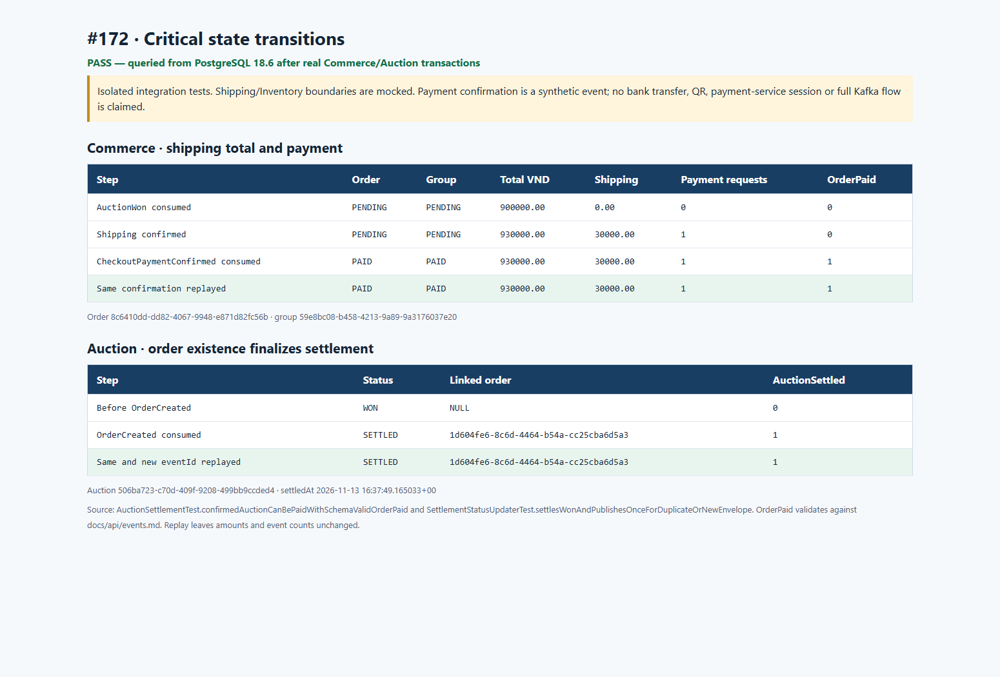

# Auction settlement #172

`AuctionWon` creates a singleton PENDING group/order from the event snapshot.
Only shipping confirmation fixes the final total and writes the payment manifest.
AUCTION `OrderCreated` moves WON to SETTLED and writes `AuctionSettled` atomically.
The existing hold is linked by #170/#209; stock is committed later on OrderPaid.

## Focused tests

After `mvn install` in `lib`, run with Java 21 in the indicated service:

```powershell
# commerce-service: no Docker required
mvn '-Dtest=AuctionOrderServiceUnitTest,AuctionShippingServiceUnitTest,AuctionShippingContractTest,CheckoutPaymentConfirmedConsumerTest,OrderShippingServiceTest' test
# auction-service: no Docker required
mvn '-Dtest=SettlementStatusUpdaterUnitTest,AuctionStateMachineTest' test
# shipment-service: no Docker required
mvn '-Dtest=ShippingQuoteServiceTest,ShippingControllerTest' test
```

Unit tests cover immutable price/deadline/item snapshots, duplicate references,
owner/role/state/hold guards, numeric(19,2) total bounds, normalized address replay,
one payment manifest, WON → SETTLED, unchanged winner/price, one WARN outside WON,
event identity and propagation of outbox failures. They do not prove DB rollback.

`AuctionSettlementTest` and `SettlementStatusUpdaterTest` exercise real PostgreSQL,
Flyway, JPA, outbox and processed markers, including concurrent envelopes/requests
and rollback. They start Testcontainers by default. A disposable local PostgreSQL
can be selected with `-Dsettlement.test.jdbc-url=jdbc:postgresql://127.0.0.1:55472/postgres`
(postgres user, empty password, fresh random schema per context).

```powershell
# commerce-service
mvn '-Dtest=AuctionSettlementTest' '-Dsettlement.capture=true' '-Duser.timezone=UTC' test
# auction-service
mvn '-Dtest=SettlementStatusUpdaterTest' '-Dsettlement.capture=true' '-Duser.timezone=UTC' test
```

The optional capture writes queried DB states to `target/settlement-evidence/`.
Only critical payment/settlement snapshots are retained in this MR:



Raw sources: [payment](evidence/auction172/payment-states.json),
[auction](evidence/auction172/auction-states.json).
The image renders those queried states; it is not a screenshot of a bank transfer.
Commerce and Auction use independent fixtures. Shipping/Inventory are mocked;
CheckoutPaymentConfirmed is synthetic. OrderPaid is validated against events.md.

## Validation and limits

### Upgrade from develop

The branch includes develop `aa238638`. Its Auction `V7__masked_bidder_names.sql`
and Commerce `V13__order_payment_note.sql` remain unchanged. The new settlement
migrations are `V8__auction_settled_at.sql` and `V14__auction_order_reference.sql`;
their SQL bodies are unchanged from the original #172 migrations.

From `infra/db-verification`, run with Java 21:

```powershell
mvn '-Dtest=AuctionSettlementMigrationTest' '-Duser.timezone=UTC' test
```

Testcontainers is the default. The disposable PostgreSQL URL option above also
works here. Four cases cover fresh installation and upgrades from Auction V7
and Commerce V13. They check every expected migration version, preserve existing
business rows and complete Flyway history/checksums, apply exactly one new
migration, validate, then rerun with zero migrations. They also verify nullable
`settled_at` and the auction-reference uniqueness guard without restricting
STANDARD orders or null references. Each case uses and removes its own random
schema.

On 15 November 2026 these four cases pass on PostgreSQL 18. Before the rename,
all four fail because Flyway detects duplicate V7/V13 migrations. This upgrade
check covers the develop schema; complete Kafka/payment/notification acceptance
remains pending as described below.

The merged branch also passes 82 focused Commerce tests, 104 Auction tests and
the OpenAPI inventory check for 104 operations. These are local focused runs,
not full-service verify or remote CI results.

Verified on the MR source based on develop `09b3cf6f`, 13–14 November 2026:
Commerce 101, Auction 104, Shipment 69 and Gateway 83 tests pass, zero failure/error/skip.
Common-events 22 and shared-library reactor install pass. The reference lookup
uses `idx_orders_reference` with 1,000 extra orders. Full service verify/CI and
live #170 → Kafka → Commerce → Payment QR/bank/notification flow are not claimed.

Shipment quote now accepts optional `applyFreeShipping` (absent/null = true).
Auction quotes send false to receive the carrier fee; Commerce applies its
configured threshold to finalPrice. Regression first failed with expected 30000
but actual 0 when Catalog price qualified; after the fix standard callers retain
their existing free-shipping behavior and auction totals use the winning price.

API inventory passes 101 operations. Commerce/Shipment OpenAPI lint passes;
Commerce has five path ambiguity advisories, including the required new path
versus `/orders/groups/{id}`. Gateway uses CHECKOUT.START; service also checks
BUYER and winner ownership. Settlement does not create another reservation.
